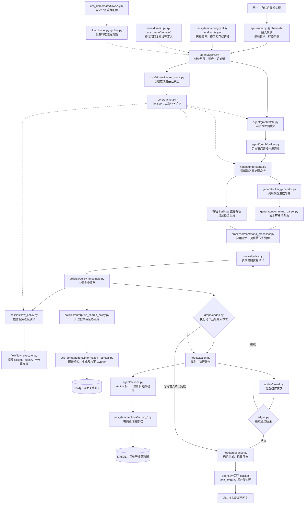

# 项目一代码导读：框架图、文件作用与阅读顺序

这份文档配合《项目一面试稿》使用。目的不是背文件名，而是理解：谁接收请求、谁理解语言、谁决定下一步、谁操作数据库、谁保存记忆。依据当前源码静态阅读，不代表所有部署和异常场景均已运行验证。

## 1. 先认识两个大目录

| 目录 | 通俗理解 | 为什么要分开 |
|---|---|---|
| `atguigu_ai/` | 通用对话引擎：类似可以装不同业务的机器 | 不把订单、物流规则写死在框架里 |
| `ecs_demo/` | 电商业务应用：装到机器上的具体业务 | 放订单流程、话术、数据库操作和商品检索 |

举例：以后换成运营商报修助手，通用引擎可以继续使用；订单 Action 要换成报修 Action，电商 Flow 要换成报修 Flow。复用不代表无需重新设计权限和业务约束。

## 2. 整体框架图

实线表示主要处理关系；虚线表示配置、组件或状态依赖。检索分支是否执行，由实际策略和当前状态决定，并非每条消息都会经过。



注意：图是模块协作示意，不表示每个方框都是一个独立 LangGraph 节点。真正的图节点只有 Understand、Policy、Action、Guard、Response。Response 当前主要完成状态标记和日志记录，回复可以在前面的动作等环节生成，不能把它理解为“必定再调用一次大模型”。

## 3. 用客服团队理解核心名词

| 名词 | 类比 | 在项目中的实际含义 | 不能混淆的点 |
|---|---|---|---|
| Channel | 电话、网页等接待窗口 | 输入输出适配 | 不负责决定订单能否取消 |
| Agent | 客服主管 | 装配组件并处理一轮消息 | 不是单独一个大模型 |
| LLM | 理解客户意思的助手 | 将自然语言转换为命令等 | 模型输出不是业务事实 |
| Command | 内部指令单 | 设置槽位、开始流程等结构化操作 | 命令不等于数据库事务 |
| Policy | 调度规则 | 根据状态预测下一动作 | 与业务 Action 不同 |
| Action | 执行专员 | 查订单、修改数据、生成回复等 | 执行时仍要验证权限 |
| Flow | 业务办事指南 | 收集信息、执行动作、判断分支的步骤 | 不等于五节点通用图 |
| Tracker | 当前客户的业务档案 | 槽位、对话与流程进度 | 不等于模型参数 |
| Slot | 档案中的字段 | order_id、是否确认等 | 用户填入不代表可信 |
| Domain | 字段与话术字典 | 槽位、回复模板等领域定义 | 不等于订单数据库 |
| Stack | 暂停任务的记录夹 | 保存流程帧和恢复位置 | 不是 Python 函数调用栈本身 |
| Retriever | 查资料的助手 | 检索流程候选或知识 | 不同检索器查的对象不同 |
| NLG | 话术组织 | 模板生成或重述回复 | 不应改变业务事实 |

## 4. 接入、装配与通用图：文件逐个解释

以下路径相对于仓库根目录。优先级：A 为第一轮必读，B 为理解主线后阅读。

| 文件 | 作用：做什么 | 目的：为什么需要 | 重点知识 / 优先级 |
|---|---|---|---|
| `atguigu_ai/api/server.py` | 定义 FastAPI 服务、请求响应结构与路由等 | 把对话能力提供给外部客户端 | HTTP、WebSocket、输入验证；A |
| `atguigu_ai/channels/rest_channel.py` | REST 渠道适配 | 统一不同入口的消息处理 | 渠道与业务解耦；B |
| `atguigu_ai/channels/socketio_channel.py` | Socket.IO 渠道适配 | 支持事件式通信接入 | Socket.IO 与原生 WebSocket 不是同一协议；B |
| `atguigu_ai/channels/console_channel.py` | 命令行对话入口 | 本地交互调试 | 调试渠道；B |
| `atguigu_ai/agent/agent.py` | 创建模型、策略、存储等组件；handle_message 调图并保存状态 | 让外部调用者只面对统一入口 | 装配、门面模式、对象生命周期；A |
| `atguigu_ai/agent/graph/builder.py` | 添加五个节点和边，编译并复用图 | 集中描述执行拓扑 | StateGraph、条件边、单例；A |
| `atguigu_ai/agent/graph/state.py` | 定义 MessageProcessingState 和初始状态 | 约定各节点共享哪些数据 | TypedDict、本轮状态、组件引用；A |
| `atguigu_ai/agent/graph/edges.py` | 根据完成标志、动作预测和次数选择下一节点 | 将路由判断集中管理 | 控制流、终止条件；A |
| `atguigu_ai/agent/graph/nodes/understand.py` | 记录输入；生成并处理命令；直接解析按钮 | 将输入变成可执行的内部语义 | 自然语言与按钮两条路径；A |
| `atguigu_ai/agent/graph/nodes/policy.py` | 调用策略集合产生当前预测 | 决定下一步做什么 | 决策与执行分离；A |
| `atguigu_ai/agent/graph/nodes/action.py` | 执行动作、积累回复并更新相关状态 | 真正推动业务和对话前进 | 副作用、异常与动作计数；A |
| `atguigu_ai/agent/graph/nodes/guard.py` | 达到最大动作数时终止循环 | 防止单轮动作无限执行 | 次数上限不是超时或授权；A |
| `atguigu_ai/agent/graph/nodes/response.py` | 标记本轮完成并记录执行信息 | 收束图执行 | 不负责保证业务成功；A |
| `atguigu_ai/agent/actions.py` | Action 抽象、注册查找与标准动作等 | 让框架能统一调用不同业务动作 | 接口、注册表、插件扩展；A |
| `atguigu_ai/agent/message_processor.py` | 另一套消息处理实现 | 理解历史实现与图编排的关系 | 当前主线先看 agent.py 的实际调用，不默认它同时执行；B |

## 5. 理解、命令和策略

| 文件 | 作用 | 设计目的 | 面试关联 |
|---|---|---|---|
| `atguigu_ai/dialogue_understanding/generator/prompt_builder.py` | 构造理解阶段的提示内容 | 给模型必要的上下文和输出约束 | 历史长度、提示注入、约束边界 |
| `atguigu_ai/dialogue_understanding/generator/llm_generator.py` | 组织模型命令生成 | 将模型调用封装成统一组件 | 模型错误与结构化输出 |
| `atguigu_ai/dialogue_understanding/generator/command_parser.py` | 清理输出、按行解析 DSL/函数式命令 | 将字符串变成程序可操作对象 | ParseResult、部分成功、格式验证 |
| `atguigu_ai/dialogue_understanding/commands/base.py` | 命令公共接口与注册解析基础 | 为不同命令定义共同协议 | 多态、注册机制 |
| `atguigu_ai/dialogue_understanding/commands/slot_commands.py` | 槽位相关命令 | 表达需要写入哪些对话字段 | 类型验证、槽位白名单 |
| `atguigu_ai/dialogue_understanding/commands/flow_commands.py` | 流程相关命令 | 表达开始或控制流程的意图 | 流程切换、合法状态 |
| `atguigu_ai/dialogue_understanding/processor/command_processor.py` | 执行命令对 Tracker 的影响 | 将语言解析与状态变更解耦 | 命令顺序、原子性、权限 |
| `atguigu_ai/policies/base_policy.py` | 策略接口和预测结果定义 | 统一策略输入输出 | action、confidence、策略协议 |
| `atguigu_ai/policies/policy_ensemble.py` | 排序并调用策略，选择有效预测 | 协调流程和检索等不同决策来源 | 优先级不等于简单投票 |
| `atguigu_ai/policies/flow_policy.py` | 结合当前流程状态和执行器预测动作 | 让业务按步骤推进 | 等待用户与继续执行 |
| `atguigu_ai/policies/enterprise_search_policy.py` | 组织知识检索与回答路径 | 处理需要知识查询的请求 | 检索失败、证据与回答 |
| `atguigu_ai/shared/llm/base_client.py` | 模型客户端公共抽象 | 减少上层对具体服务商的依赖 | 接口隔离 |
| `atguigu_ai/shared/llm/langchain_client.py` | 基于 LangChain 的模型访问实现 | 适配模型配置与调用 | 兼容接口不代表所有模型能力一致 |

完整关系：提示构造 → 模型生成文本 → Parser 得到命令对象 → Processor 修改 Tracker → Policy 选择 Action。不要把 Parser 说成“执行了订单取消”。

## 6. 状态、流程和持久化

| 文件 | 作用 | 目的与相关知识 |
|---|---|---|
| `atguigu_ai/core/tracker.py` | 对话状态、用户/机器人消息、槽位访问、流程控制与序列化 | 保存跨轮记忆；重点看 get_slot、set_slot、start_flow、end_flow、to_dict/from_dict |
| `atguigu_ai/core/slots.py` | 槽位对象与创建逻辑 | 将字段定义和值的处理集中；不要仅凭槽位类型假定业务验证完整 |
| `atguigu_ai/core/domain.py` | 领域定义加载和管理 | 把槽位与话术等定义从执行逻辑分离 |
| `atguigu_ai/core/stores/tracker_store.py` | 存储公共接口与获取/创建状态逻辑 | 上层无需知道数据保存在哪里 |
| `atguigu_ai/core/stores/json_store.py` | Tracker 转 JSON 文件或内存字典 | 简化开发；注意同步 I/O、文件名碰撞、并发覆盖 |
| `atguigu_ai/core/stores/mysql_store.py` | MySQL 存储实现 | 提供另一持久化方式；存在该文件不等于生产配置已经启用 |
| `atguigu_ai/dialogue_understanding/flow/flow.py` | Flow、FlowStep、FlowsList 等数据结构 | 将配置转换为可索引、可查找的流程对象 |
| `atguigu_ai/dialogue_understanding/flow/flow_loader.py` | 加载流程定义 | 将读 YAML 的工作与执行步骤分开 |
| `atguigu_ai/dialogue_understanding/flow/flow_executor.py` | 解释收集槽位、动作、分支、call/link 等步骤 | 通用业务流程执行器；重点追踪当前步骤如何推进 |
| `atguigu_ai/dialogue_understanding/stack/dialogue_stack.py` | 对话栈管理 | 组织当前和暂停的流程帧 |
| `atguigu_ai/dialogue_understanding/stack/stack_frame.py` | 栈帧数据结构 | 记录某个流程的执行上下文；理解暂停和恢复 |

三个最容易混淆的状态：

| 状态 | 例子 | 生命周期 |
|---|---|---|
| 图状态 | 本轮 action_count、current_prediction、final_responses | 一次消息处理 |
| 对话状态 | order_id、当前业务流程、历史消息 | 跨多轮；按存储实现保存 |
| 业务数据 | 数据库中的订单状态、收货地址 | 独立于对话存在，由业务事务控制 |

Tracker 说“已确认取消”，不代表订单数据库一定提交成功；数据库取消成功，也不代表 Tracker 一定保存成功。这就是幂等和恢复问题的来源。

## 7. 电商应用目录：真正的业务在哪里

| 文件 | 作用 | 为什么要有它 / 关键细节 |
|---|---|---|
| `ecs_demo/config.yml` | 选择理解组件与策略，配置 GraphRAG 类路径 | 决定使用哪些能力；当前能看到 LLMCommandGenerator、FlowPolicy、EnterpriseSearchPolicy |
| `ecs_demo/endpoints.yml` | 模型、存储等端点配置 | 决定服务连接到哪里；学习时不要复制密钥到文档 |
| `ecs_demo/domain/domain_order.yml` | 订单相关槽位和话术等 | 定义订单对话的字段与表达 |
| `ecs_demo/domain/domain_logistics.yml` | 物流相关领域配置 | 把物流话术与 Python 分开 |
| `ecs_demo/domain/domain_postsale.yml` | 售后领域配置 | 为售后收集字段和响应提供定义 |
| `ecs_demo/domain/domain_patterns.yml` | 通用对话模式相关配置 | 支持通用场景表达，具体内容以配置为准 |
| `ecs_demo/data/flows/flow_order.yml` | 切换账号、查订单、改地址、取消订单 | 展示 collect、条件分支、步骤跳转、确认等能力 |
| `ecs_demo/data/flows/flow_logistics.yml` | 查快递公司、查订单物流 | 复用订单选择再执行物流查询 |
| `ecs_demo/data/flows/flow_postsale.yml` | 申请售后 | 按步骤选择订单、检查条件、收集类型和原因、提交 |
| `ecs_demo/actions/action_order.py` | 查询、地址处理、取消等订单 Action | 真正读写业务数据；重点检查归属、状态、事务和重复请求 |
| `ecs_demo/actions/action_logistics.py` | 物流业务动作 | 连接物流流程与数据查询，不默认等于外部实时物流 API |
| `ecs_demo/actions/action_postsale.py` | 售后业务动作 | 实现售后条件检查和申请等具体逻辑 |
| `ecs_demo/actions/db.py` | 业务数据库连接与会话基础 | 统一数据库访问资源 |
| `ecs_demo/actions/db_table_class.py` | SQLAlchemy 业务表模型 | 把订单、地址等表映射为 Python 对象 |
| `ecs_demo/gen_data.py` | 业务演示数据生成入口 | 准备演示数据；执行前确认目标库，不能当作只读脚本 |

特别注意：`core/stores/mysql_store.py` 存的是对话状态；`ecs_demo/actions/db.py` 对应的业务数据库访问用于订单等数据。即使都叫 MySQL，存的内容与一致性要求也不一样。

## 8. 检索与回复文件

| 文件 | 作用 | 学习目的 |
|---|---|---|
| `atguigu_ai/retrieval/base_retriever.py` | 检索接口、结果结构等公共约定 | 上层策略用统一方式调用不同检索实现 |
| `atguigu_ai/retrieval/flow_retriever.py` | 流程候选检索 | 查“应该走哪个业务”，不是查订单事实 |
| `atguigu_ai/retrieval/embedder.py` | 文本向量表示组件 | 理解语义相似度如何参与候选召回 |
| `ecs_demo/addons/create_indexing.py` | 图谱检索索引构建相关逻辑 | 理解向量/全文索引准备；运行前检查是否修改数据库 |
| `ecs_demo/addons/information_retrieval.py` | GraphRAG 实现：路由、入口检索、Cypher 生成验证校正、查询和结果包装 | 理解关系知识查询链路；不等于每次查询都有安全保证 |
| `atguigu_ai/nlg/nlg_generator.py` | 回复生成公共接口 | 将话术处理与业务执行分离 |
| `atguigu_ai/nlg/template_nlg.py` | 基于模板生成回复 | 让可控业务提示保持稳定 |
| `atguigu_ai/nlg/response_rephraser.py` | 对回复进行语言重述 | 改善表达；重述不能改变订单状态、金额等事实 |

检索链路示意：

```text
问题 → 识别节点类型/实体 → 检索入口节点 → 生成 Cypher
    → 验证 → 必要时校正 → 关系方向校正 → Neo4j 查询
    → 包装为 SearchResult → 上层组织回答
```

Cypher 是 Neo4j 的查询语言，可类比关系数据库中的 SQL。Embedding 是把文本转为数值向量；向量相近通常用于判断语义相近，但不是事实正确性的证明。

## 9. 一次取消订单，具体看哪些文件

| 顺序 | 发生什么 | 看哪里 | 读懂后的自测 |
|---|---|---|---|
| 1 | 用户输入“取消订单” | server.py、agent.py | 请求如何变成 message 和 sender_id？ |
| 2 | 取出业务记忆 | tracker_store.py、tracker.py | 新会话与老会话有什么不同？ |
| 3 | 创建本轮状态并启动图 | state.py、builder.py | 哪些字段每轮重新初始化？ |
| 4 | 理解并应用命令 | understand.py、llm_generator.py、command_parser.py、command_processor.py | 模型输出在哪里变成状态修改？ |
| 5 | 决定业务下一步 | policy.py、policy_ensemble.py、flow_policy.py | 谁选择下一动作？ |
| 6 | 解释 cancel_order 的配置 | flow_order.yml、flow_executor.py | goto、collect、if、action 分别干什么？ |
| 7 | 展示可取消订单并收集选择 | action_order.py | 候选范围与身份从哪里来？ |
| 8 | 等待用户确认 | edges.py、Tracker | 为什么本轮结束后业务还能继续？ |
| 9 | 下一轮确认，执行取消 | understand.py、action.py、action_order.py | 按钮是否经过模型？最终写操作有没有重新授权？ |
| 10 | 结束并保存对话状态 | guard.py、response.py、agent.py、json_store.py | 数据库提交后状态保存失败怎么办？ |

不要尝试一次读完整个仓库。先沿这个案例找到实际函数，再扩展到修改地址和知识查询。

## 10. 第一轮可以暂缓的文件

`training/`、`training/finetune/`、`cli/export.py` 等先放到主线之后。文件名带 train 或 finetune 不能单独证明完成了模型微调；需继续核实入口实际做的是数据处理、配置打包、索引准备还是参数训练。

`__init__.py` 通常用于包组织和导出接口，也可能包含注册逻辑；`__main__.py` 是包运行入口；`setup.py` 是项目打包配置。它们不是订单业务主逻辑，但排查导入和启动问题时会用到。

## 11. 面试时如何提文件而不堆文件名

不建议：“我用了 builder.py、state.py、edges.py。”

建议：“我把对话拆为五个通用阶段，通过条件边控制继续执行还是等待用户；构图、共享状态和路由规则分别放在三个模块里，方便独立理解与修改。”

再追问实现位置时，才补充具体路径。面试官先要理解设计，再需要代码证据。

## 12. 阅读顺序与完成标准

1. `agent.py`：能复述“取状态—调图—存状态”。
2. `builder.py + state.py + edges.py`：能画五节点与两条条件路由。
3. `flow_order.yml + action_order.py`：能解释取消订单的每一步。
4. `tracker.py + json_store.py`：能区分对话记忆和业务数据库。
5. `understand.py + command_parser.py + command_processor.py`：能解释语言如何变成状态变化。
6. `policy_ensemble.py + flow_policy.py + flow_executor.py`：能解释下一动作如何产生。
7. `information_retrieval.py`：能说明知识查询与订单操作的不同。

最终自测：不看文档，画出一次请求和一次用户确认的两轮执行过程；标出模型调用、数据库写入和 Tracker 保存的位置；给每个失败点提出一种验证或恢复方法，并明确哪些尚未实现。
